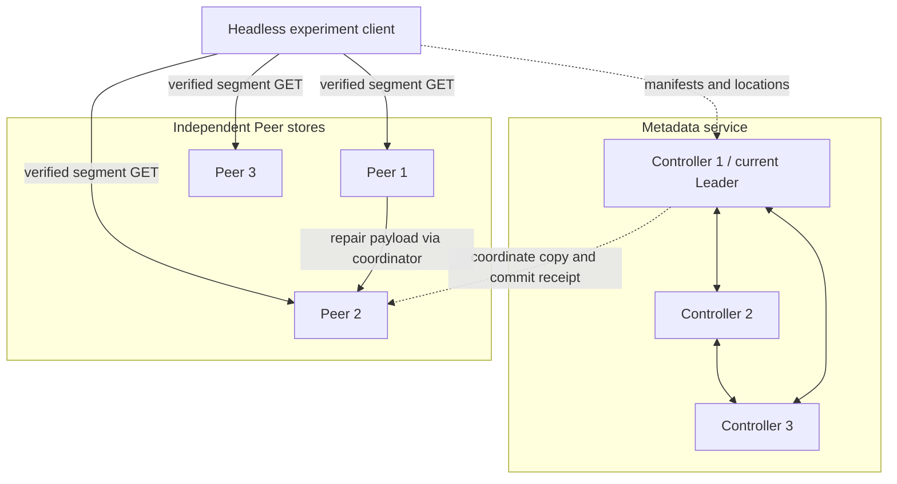

# Presentation layout by section

TODO(team): Maintain the presentation structure and references to verified experiment exhibits.

This is a production plan for the presentation, organized by subject rather than a fixed page limit. Start with approximately **25 main slides across nine sections**. Add a demo and appendix when useful. These counts are recommendations: split a slide if its figure or explanation needs more room. There is no ten-slide or ten-minute constraint in this layout.

The argument is: explain the system and its resource conflict; define the research questions and policies; explain how the study was controlled; present each experiment; then state the measured answers and limits.

## Result locations and how to use this document

Repository root: `/Users/wanghaoyu/Desktop/cs512Project`.

| Material | Location from repository root | Use |
|---|---|---|
| All existing charts and visual tables | `results/compact-study/figures/` | 13 visualizations, each as PNG and SVG |
| Packaged figures and tables | [slides-and-tables.zip](../results/compact-study/slides-and-tables.zip) | Convenient asset bundle |
| Grouped numerical results | [aggregate.csv](../results/compact-study/aggregate.csv) | Rebuild editable result tables |
| Run summaries | [summary.csv](../results/compact-study/summary.csv) | Individual policy/seed outcomes |
| Paired effects | [paired-contrasts.csv](../results/compact-study/paired-contrasts.csv) | Matched differences, individual values and ranges |
| Viewer outcomes | [sessions.csv](../results/compact-study/sessions.csv) | All 396 scheduled performance viewers |
| Controller outcomes | [controller-summary.csv](../results/compact-study/controller-summary.csv) | All nine E5 cases |
| Measurement detail | [measurement-audit.csv](../results/compact-study/measurement-audit.csv) | First task/byte observations, recovery mechanism and counter timing |
| Complete written findings | [compact-study-results.md](../report/compact-study-results.md) | Evidence and qualification of every conclusion |
| Experiment explanation | [experiment-explanation.md](experiment-explanation.md) | Procedures, controls, policies, metrics and raw evidence |

Use PNG for quick insertion and SVG for scalable figures. Prefer editable PowerPoint tables for small numerical comparisons; use the CSV or the exact tables below. Do not crop away units, completion counts or censoring information. Full file links below resolve from this `presentation/` folder.

**Existing assets versus planned diagrams:** all linked PNG/SVG result assets already exist. Architecture, protocol and fault-schedule drawings described below are diagrams to assemble when making the deck. Their labels and editable source specifications are provided here; they are not existing screenshots. No uncollected UI screenshot is presented as measured evidence.

## Section overview

| Part | Subject | Recommended main slides | Why this much space |
|---|---|---:|---|
| 1 | System introduction and structure | 5 | Establish the problem, architecture and implemented protocol |
| 2 | Research questions and repair policies | 3 | Separate the questions, baselines and proposed control rule |
| 3 | Experimental setup and measurement | 2 | Explain local process emulation and fair comparisons |
| 4 | E1: repair interference | 2 | Separate experiment design from completion/stall findings |
| 5 | E2: repair grace | 2 | Explain brief/persistent outages before comparing cost |
| 6 | E3: policy comparison | 3 | Design, overall scorecard and a concrete tradeoff |
| 7 | E4: second-holder failure | 2 | Explain the targeted probe and the availability boundary |
| 8 | E5: Controller and task recovery | 4 | Overview plus a separate page for each failure case |
| 9 | Conclusions and limitations | 2 | Answer all questions and bound the claims |
| **Main presentation** | | **25** | A content-based starting point, not a page ceiling |
| Optional | Live/recorded demo | 1–2 additional | Keep demonstration separate from performance evidence |
| Appendix | Definitions, full tables and implementation evidence | About 6 | Detailed answers without crowding main pages |

Use section-relative page labels below, such as 4.1 and 4.2. Assign final slide numbers only after choosing optional pages.

## Part 1 — System introduction and structure

**Recommended: five slides.** The audience should understand what the application does, where bytes and metadata live, and why repairing a missing replica can interfere with viewers.

### 1.1 — Cooperative video storage and the repair problem

**Talk about:** video is divided into segments, each initially held by two Peers. A surviving holder can serve a viewer after one holder fails, but making a replacement copy consumes the same source upload service.

**Put on the page:** project title/team/course, a one-sentence motivation, and a simple resource-conflict illustration. Suggested sentence: “Restoring redundancy uses upload capacity that current viewers also need.”

**Layout:** title at top; one diagram over the middle two thirds; motivation sentence along the bottom. Keep names and course information small. If this is crowded, move motivation to a separate page and retain a minimal cover.

**Diagram to assemble:** a failed original Peer; one surviving Peer with a single upload-budget label; a viewer; a replacement Peer. Draw separate outgoing arrows from the surviving Peer to the viewer and replacement. Label them “foreground delivery” and “repair copy.” This is an explanatory illustration, not a measured traffic trace. Do not put arbitrary numerical benefits on it.

**Source:** [repair coordinator](../internal/control/coordinator.go), [shared source service](../internal/storage/handlers.go), and [repair controls](../internal/storage/traffic.go).

### 1.2 — Control plane and data plane

**Talk about:** Controllers replicate metadata through Raft; Peers store and serve the bytes. The experimental client downloads directly from Peers. Browser playback uses a separate Gateway path.

**Layout:** large architecture diagram across the center; a short legend underneath. Use solid arrows for payloads and dashed arrows for metadata. Put Controllers on the upper row, Peers on the lower row, and the headless client to the left. If showing the browser, place it on a separate optional branch so the measured path remains obvious.

**Labels required:** three Controller processes, one current Leader, Raft links, manifests, committed replica receipts, READY state, persistent tasks, three Peer stores, and HTTP segment GET/PUT.

**Editable diagram specification:**

The repair arrow summarizes source→coordinator→target transfer; it must not imply a Peer autonomously initiates a direct copy. Add “three Controllers + three Peers emulated as separate local processes” below the diagram. This is not six physical computers.

**Source:** [architecture notes](../docs/architecture.md), [metadata service](../internal/metadata/handlers.go), [coordinator copy implementation](../internal/control/coordinator.go).

### 1.3 — Publication and byte verification

**Talk about:** a segment existing somewhere is not enough to publish the video. The application requires validated durable copies on distinct Peers and committed confirmations before READY.

**Layout:** left 70%: sequence diagram. Right 30%: three short invariants: distinct holders, committed registration, size/SHA-256 checks.

**Sequence to draw:** ingest → create DRAFT manifest → obtain placement → PUT each segment to distinct Peers → receive durable receipts → verify and commit confirmations → publish READY. Show payload PUTs outside the Raft log and metadata commands inside it.

**Sources:** [ingestion script](../scripts/ingest/ingest.py), [metadata handlers](../internal/metadata/handlers.go), [immutable store](../internal/storage/store.go). This is a conceptual protocol drawing, not a new benchmark result.

### 1.4 — Delivery recovery and redundancy recovery

**Talk about:** trying another source may let playback continue before a replacement is installed. These are different milestones and need different measurements.

**Layout:** two horizontal tracks. Upper: viewer requests failed holder → alternate source → verified delivery. Lower: detect shortage → grace → committed pending task → copy → verify target → committed replacement. Use a shared failure marker at the left. Do not use an exact time scale for this conceptual drawing.

**Bottom statement:** “Playback continuity does not prove that redundancy has been restored.”

**Sources:** [playback engine](../internal/playback/engine.go), [repair coordinator](../internal/control/coordinator.go), [maintenance task lifecycle](../internal/metadata/maintenance.go).

### 1.5 — Implemented system and validation

**Talk about:** what the team built and what the libraries supply. Distinguish application protocols from the consensus implementation.

**Layout:** left: a small responsibility table; right: a short validation checklist. A rehearsed UI screenshot may replace the checklist only if captured later and labeled as demonstration.

| Application implementation | External foundation/tool |
|---|---|
| Publication, replica confirmation and repair task lifecycle | HashiCorp Raft consensus library |
| Durable Peer index, immutable blobs and hash validation | Go HTTP and storage facilities |
| Playback engine, repair budgets and experiment harness | FFmpeg/FFprobe for the separate media gate |

**Evidence:** [archived validation gates](../results/compact-study/validation/gates.json). Say build, static/race, smoke, repair, cleanup, deletion and media gates passed. Do not call this browser-continuity validation.

**Optional demo insertion:** add one or two pages after this part: a demo holding page and, if useful, one annotated screenshot. Rehearse the actual browser beforehand. The stored headless experiment figures are not substitutes for UI screenshots or a browser demonstration.

## Part 2 — Research questions and repair policies

**Recommended: three slides.** Introduce the comparisons before presenting their outcomes.

### 2.1 — Research questions

**Layout:** three plain rows, each with its question and experiment IDs. Avoid a dense paragraph.

| Question | What we ask | Evidence |
|---|---|---|
| RQ-A | When does repair interfere with delivery, and what does grace change? | E1, E2 |
| RQ-B | Does load-aware repair improve the playback/recovery compromise over fixed caps? | E3, E4 |
| RQ-C | What correctness and recovery behavior survives failures? | E0, E4, E5 |

**Talk about:** the contribution is a working application and a controlled comparison of repair controls. An unsupported policy hypothesis can still produce a complete answer. Do not claim replication, Raft or throttling was invented by this project.

**Sources:** [executed findings](../report/compact-study-results.md), [original research focus](../report/literature-review-and-research-focus.md). Add a separate related-work page only if the project rubric requires it; verify its literature citations before making a deck.

### 2.2 — Treatments and a common upload budget

**Layout:** policy table over most of the page; a single common-cap diagram underneath.

| ID | Treatment |
|---|---|
| N | No Peer failure; ordinary repair service available |
| OFF | Peer failure; automatic repair disabled |
| S | Peer failure; shared upload service and configured grace |
| F25 | S plus an additional repair rate cap at 25% of the source cap |
| F50 | S plus an additional repair rate cap at 50% |
| L | Busy/idle adaptation plus a pending-task age floor |

**Diagram to assemble:** foreground requests → common total limiter; repair requests → additional repair limiter → the same common limiter. Label the unchanged 32 KiB token burst. A cap is an allowance, not a reserved share.

**Talk about:** OFF is a diagnostic reference, not an overall winner, because it leaves redundancy reduced. All comparisons retain identical total source capacity.

**Sources:** [traffic policy implementation](../internal/storage/traffic.go), [Peer policy configuration](../cmd/peer/main.go), [scenario configuration](../experiments/scenarios/compact-repair.json).

### 2.3 — Load-aware repair rule

**Layout:** editable decision flow occupying about two thirds; exact parameters to the right. This flow is a new explanatory diagram to assemble, not an existing result image.

**Flow:** observe source activity every 250 ms → foreground active or less than two seconds continuously idle: 25% → otherwise: 100% → if oldest active committed pending task is older than 60 seconds, take `max(current allowance, 50%)` → serve repair through additional and common limiters.

**Talk about:** foreground includes GETs waiting for upload service. Task creation time is supplied outside deterministic FSM application and persisted with the task. Aging follows committed task identity, not a timestamp invented on retry.

**Visible qualification:** “The compact performance runs exercised busy/idle adaptation. The 60-second age branch was regression-tested, not activated by the performance horizon.”

**Source:** [policy and tests](../internal/storage/traffic.go), [boundary and limiter tests](../internal/storage/traffic_test.go), [persisted task model](../internal/domain/models.go). Reserve the measured [L-budget-trace.png](../results/compact-study/figures/L-budget-trace.png) for an appendix page so it is not confused with this conceptual rule.

## Part 3 — Experimental setup and measurement

**Recommended: two slides.** The local emulation must be explicit.

### 3.1 — Local deployment and controlled workload

**Layout:** left half: one host boundary containing six separate process boxes and separate storage folders. Right half: compact settings table. Label unique HTTP ports; Controllers also have separate Raft endpoints. Do not draw six unrelated physical server locations.

| Setting | Executed value |
|---|---|
| Topology | 3 Controllers + 3 Peers, separate processes on one host |
| Fixture | 9 × 128 KiB, 2 logical seconds each; exactly two initial copies |
| Peer upload caps | 96 / 144 / 192 KiB/s |
| Workload | 2 low-load viewers; 6 high-load viewers; staged 6-viewer burst |
| Failure / horizon | First fault at 5 s; 50 s observation |
| Client | Window 3, concurrency 2, startup buffer 4 s, 42 s session timeout |

**Talk about:** transfers and process failures are real; physical network isolation and independent machine resources are not. Content is deterministic byte payloads with logical video durations, not an online video used for browser playback. Real-media decoding is a separate acceptance gate.

**Sources:** [frozen study configuration](../results/compact-study/study-config.json), [isolated process helper](../tests/system/cluster.py), [workload harness](../experiments/repair_playback_study.py).

### 3.2 — Pairing, run counts and measurement

**Layout:** left: experiment matrix; right: four metric definitions. If crowded, split methodology and matrix into separate pages.

| Experiment | Scheduled comparison cells | Distinct runs added |
|---|---:|---:|
| E1 | 18 | 18 |
| E2 | 18 | 15, reusing three E1 cells |
| E3 | 24 | 21, reusing the same three high-load S cells |
| E4 | 18 | 18 |
| E5 | 9 | 9 |
| Total | 87 memberships | **81 unique runs** |

**Metric labels:** completion over all scheduled viewers; post-fault observed stalls including failed sessions; verified two-copy restoration; repair payload and one-copy byte-seconds.

**Talk about:** three paired workload/fault contexts, with first-failed capacity rotated; E4 has two. Treatment order is shuffled separately. The same cell shared by E1/E2/E3 runs once. Seed is not a synonym for an independent physical machine. Viewers within one run are correlated.

**Footer:** “81 unique runs in 67.9 min; 396 performance viewer outcomes; real HTTP / simulated consumption; approximately 2 s copy-verification cadence.”

**Sources:** [matrix.json](../results/compact-study/matrix.json), [execution.json](../results/compact-study/execution.json), [analysis-audit.json](../results/compact-study/analysis-audit.json).

## Part 4 — E1: does repair interfere with delivery?

**Recommended: two slides.**

### 4.1 — E1 design and contrasts

**Layout:** top: N/OFF/S treatment rows. Bottom: common timeline with viewer arrivals near 0, first failure or marker at 5 s, and observation ending at 50 s.

**Put on the page:** low=2 viewers; high=6; main grace=3 s; persistent absence; three paired contexts. Define OFF−N as Peer-loss effect and S−OFF as repair's additional observed effect. Both loss and later repair benefits can enter these contrasts.

**New diagram:** draw the common schedule from the settings above. Source data example: [high-load S trace, seed 1101](../results/compact-study/peer-high-S-3-persistent-0-1101/workload-and-fault-trace.json).

### 4.2 — E1 results: completion and stalls

**Layout:** existing [E1-contention.png](../results/compact-study/figures/E1-contention.png) across about 75% of the page, preserving both demand panels and completion labels. Put two short findings below. Use [E1-contention.svg](../results/compact-study/figures/E1-contention.svg) for vector insertion.

**Talk about:** low-load N/OFF/S each completed 6/6 viewers with zero post-fault stalls. High-load N completed 18/18; OFF and S each completed 7/18. In the feasible slowest-Peer-failure context, all six viewers finished and S added 3.46 s/viewer versus OFF.

**Suggested takeaway:** “Repair added stalls in a feasible contended context; spare-capacity runs had no observed stalls.”

**Source table:** [aggregate.csv](../results/compact-study/aggregate.csv), E1 rows. Keep completion beside stalls. The high-load all-context mean S−OFF is +1.22 s, with a −0.13 to +3.46 s paired range; this is not a population estimate.

**Optional extra page:** [E1-paired-effects.png](../results/compact-study/figures/E1-paired-effects.png), full width. Explain that negative observed stall differences can arise from early failures. Keep the completion table visible on this extra page.

## Part 5 — E2: what does repair grace change?

**Recommended: two slides.**

### 5.1 — E2 design: brief versus persistent absence

**Layout:** two timeline rows. Both fail at 5 s. Brief row restarts the original Peer at 9 s; persistent row remains stopped to 50 s. Beneath them, list grace values 1/3/8 s.

**Talk about:** same six-viewer workload and initial placement; only grace/outage type varies. A started task may continue after the original holder returns. Recovery through the original Peer is different from recovery through a replacement.

**Sources:** [configuration](../results/compact-study/study-config.json), [brief trace example](../results/compact-study/peer-high-S-1-brief-0-1101/workload-and-fault-trace.json), [measurement-audit.csv](../results/compact-study/measurement-audit.csv).

### 5.2 — E2 results: traffic saved and exposure retained

**Layout:** [E2-grace.png](../results/compact-study/figures/E2-grace.png) full width, with one takeaway beneath each panel. Preserve MiB and MiB·s as different units.

**Left finding:** brief absence: 1 s grace copied 0.125 MiB/run; 3/8 s copied zero. Persistent absence: all settings copied 0.75 MiB/run.

**Right finding:** persistent one-copy exposure averaged 17.42 / 18.24 / 20.20 MiB·s at grace 1/3/8 s.

**Explain the unit:** 0.75 MiB remaining at one copy for ten seconds contributes 7.5 MiB·s. This is exposure, not measured loss probability.

**Suggested takeaway:** “Grace avoided short-outage work but increased sampled reduced-redundancy exposure for persistent absence.”

**Sources:** [E2-grace.svg](../results/compact-study/figures/E2-grace.svg), E2 rows in [aggregate.csv](../results/compact-study/aggregate.csv). Tiny brief-exposure differences should not be interpreted beyond verification cadence.

## Part 6 — E3: policy comparison

**Recommended: three slides.** Use additional pages for source-specific results if the audience wants them.

### 6.1 — E3 design: steady and burst demand

**Layout:** left: S/F25/F50/L and common grace=3 s. Right: two viewer-arrival timelines. Steady has six arrivals near epoch; burst has two near epoch, two at 4/4.2 s, two at 12/12.2 s. Mark the same fault at 5 s.

**Talk about:** same content, cap, placement and failed holder within each seed. Compare L against both fixed caps. The objective is verified full restoration by 40 s after the fault; a 50 s workload horizon leaves 45 s after the first fault. Do not confuse these time origins.

**Sources:** [configuration](../results/compact-study/study-config.json), [trace generation](../experiments/repair_playback_study.py). Explain that the one-second meaningful stall threshold and five-percentage-point completion-loss criterion are engineering comparisons, not statistical guarantees.

### 6.2 — E3 scorecard: completion and recovery

**Layout:** [E3-policy-table.png](../results/compact-study/figures/E3-policy-table.png) alone over most of the page, with a short conclusion underneath. For a native table, rebuild from E3 rows of [aggregate.csv](../results/compact-study/aggregate.csv). If the table is too small, split steady and burst into two pages rather than shrinking it.

**Talk about:** all policies completed 7/18 steady and 9/18 burst viewers. All steady cases were verified by the target; burst target counts were S=2/3, F25=1/3, F50=2/3, L=1/3. One F25 burst run was unrecovered at the horizon.

**Visible note:** “F25 burst median excludes one censored run.” Do not rank that 37.08 s observed-only median as faster than the other policies overall.

**Suggested takeaway:** “L did not consistently improve the measured compromise over F50.”

**Asset:** [E3-policy-table.svg](../results/compact-study/figures/E3-policy-table.svg).

### 6.3 — E3 tradeoff and a concrete context

**Layout:** use [E3-tradeoff.png](../results/compact-study/figures/E3-tradeoff.png) on its own page. Put the local comparison in a small editable table under the plot, or give it a separate page if labels become crowded.

| High demand, slowest Peer fails | F50 | L |
|---|---:|---:|
| Completed | 6/6 | 6/6 |
| Post-fault stall / viewer | 8.53 s | 6.88 s |
| First verified full restoration | 33.99 s | 36.06 s |
| Sampled one-copy exposure | 18.82 MiB·s | 20.38 MiB·s |

**Talk about:** L saved 1.65 s of stall in this context while restoration was observed 2.07 s later. It moved the compromise rather than dominating F50. Across all steady contexts, L−F50 averaged −0.55 s; under bursts it averaged +0.01 s. Small samples and approximately two-second verification matter.

**Assets:** [E3-tradeoff.svg](../results/compact-study/figures/E3-tradeoff.svg); source-specific table [E3-high-by-failed-peer.png](../results/compact-study/figures/E3-high-by-failed-peer.png). Use the source-specific table in the appendix unless adding another main page.

## Part 7 — E4: second-holder failure

**Recommended: two slides.** This section answers an availability-boundary question, not a data-loss-probability question.

### 7.1 — E4 design and targeted delivery

**Layout:** top: the selected segment's two original holders and third replacement target. Bottom: timeline with first fault at epoch+5 s, then second fault +4/+14/+30 s after the first (epoch+9/+19/+35 s).

**Talk about:** a late-queue sentinel is selected before observing outcomes. Stop its remaining original holder regardless of repair progress, then directly GET the replacement and check size/hash and committed registration. Continuing viewers may already have the sentinel buffered.

**Sources:** [E4 example trace](../results/compact-study/peer-high-F50-3-persistent-30-1101/workload-and-fault-trace.json), [pre-second-fault observations](../results/compact-study/peer-high-F50-3-persistent-30-1101/second-fault-precondition.jsonl), [target probe and checks](../results/compact-study/peer-high-F50-3-persistent-30-1101/correctness.json).

### 7.2 — E4 results and what they establish

**Layout:** [E4-target-delivery-counts.png](../results/compact-study/figures/E4-target-delivery-counts.png) over most of the page. Below it, two statements: “Replacement unavailable in 18/18 targeted probes” and “Chosen delays did not distinguish the policies.”

**Talk about:** each cell is 0/2; policies are S/F50/L; only seeds 1101/1102 are included. Some buffered viewers nevertheless finished. The selected sentinel was not ready at any tested delay, so this experiment did not observe a transition to replacement availability.

**Visible boundary:** “Process stops retained disks; no permanent-loss or real-world loss-probability claim.”

**Asset:** [E4-target-delivery-counts.svg](../results/compact-study/figures/E4-target-delivery-counts.svg). The older [E4-second-failure.png](../results/compact-study/figures/E4-second-failure.png) contains the same zero outcomes as overlapping lines; use the count visualization for clarity.

## Part 8 — E5: Controller and task recovery

**Recommended: four slides.** Give the three failure cases distinct pages so the audience can distinguish election, usable metadata, task completion and quorum safety.

### 8.1 — E5 scenarios and endpoints

**Layout:** [E5-safety-table.png](../results/compact-study/figures/E5-safety-table.png) as the main exhibit; small test-purpose labels below.

**Talk about:** three repetitions each: Leader loss during delivery; Leader loss with a committed pending repair; majority loss and restoration. All nine passed. Success requires actual application and correctness checks, not `/health` or a Leader role string.

**State timing clearly:** E5a/b start at Leader stop. The E5c safety table starts at the recorded quorum-restore event, including process startup/election until usable metadata.

**Asset:** [E5-safety-table.svg](../results/compact-study/figures/E5-safety-table.svg), [controller-summary.csv](../results/compact-study/controller-summary.csv).

### 8.2 — E5a: active delivery through Leader loss

**Layout:** [E5-annotated-timeline.png](../results/compact-study/figures/E5-annotated-timeline.png) full width. Beneath it: “Warm and cold uncached sessions completed in 3/3 runs.”

**Talk about:** kill the actual Leader about four seconds into the warm workload; launch a new cold client; directly probe fresh quorum-backed metadata. Median application recovery was 1.52 s, range 1.47–2.74 s. The cold fixture is shorter; this is a success/recovery check, not a fair warm-versus-cold speed comparison.

**Sources:** [E5a seed 1101 injections](../results/compact-study/E5a-1101/injections.jsonl), [fresh metadata probes](../results/compact-study/E5a-1101/metadata-probes.jsonl), [client events](../results/compact-study/E5a-1101/client-events.jsonl).

### 8.3 — E5b: pending repair task survives Leader loss

**Layout:** editable sequence at left: committed task ID/creation time → Leader stop → replacement resumes same task → hash-valid target → committed registration. Right: a small check table with 3/3 for task identity/age, target verification, registration, and restart persistence.

**Talk about:** sources were slowed specifically to expose a pending task. Kill the Leader only after recording the committed pending task. Task disappearance or a missed precondition would not pass. Median 1.60 s is fresh metadata recovery, not repair-copy completion time.

**Sources:** [recorded pending task](../results/compact-study/E5b-1101/pending-task.json), [task observations](../results/compact-study/E5b-1101/tasks-and-copy-verification.jsonl), [correctness](../results/compact-study/E5b-1101/correctness.json), [policy/counter restart](../results/compact-study/E5b-1101/policy-restart.jsonl).

No existing standalone task-sequence image is supplied. Build this diagram from those actual fields; show the real task ID only as a shortened identifier, with the full ID in notes.

### 8.4 — E5c: majority loss and safe restoration

**Layout:** left: one remaining Controller and two stopped followers, then restart arrows. Right: an editable result table: isolated writes 9/9 rejected with HTTP 503; baseline retained 3/3; original operation IDs reconciled 3/3; fresh metadata after restore median 1.04 s, range 0.85–1.43 s.

**Talk about:** wait for stable isolation, submit a valid uniquely identified create command, then restart the followers and reconcile using the same ID. A queued/unknown command may commit after restoration; the property checked is no success acknowledgment during isolation.

**Sources:** [isolation write attempts](../results/compact-study/E5c-1101/isolation-writes.jsonl), [quorum timing](../results/compact-study/E5c-1101/quorum-timing.json), [reconciliation](../results/compact-study/E5c-1101/reconciliation.jsonl), [correctness](../results/compact-study/E5c-1101/correctness.json).

**Avoid:** presenting this as sustained network-partition testing. These are controlled process stops and restarts.

## Part 9 — Conclusions and limitations

**Recommended: two slides.**

### 9.1 — Answers to the research questions

**Layout:** an editable three-row conclusion table, not another chart montage.

| Question | Measured answer |
|---|---|
| RQ-A | Repair can add stalls under contention; grace avoided short-outage copies and increased persistent-outage exposure |
| RQ-B | One local L tradeoff was observed; no consistent advantage over F50 was established |
| RQ-C | Task continuity, verified replacement and quorum refusal held in the nine tested Controller cases; E4 exposed the missing-replacement boundary |

**Talk about:** distinguish an answered question from a supported superiority hypothesis. The prototype and the controlled negative/conditional findings are the project contribution.

**Source:** [executed findings](../report/compact-study-results.md). No new results should be introduced here.

### 9.2 — Scope, limitations and next experiments

**Layout:** three limitations on the left, corresponding next steps on the right.

| Tested scope / limit | Appropriate next step |
|---|---|
| Separate processes on one host share hardware and network stack | Run across physical hosts with controlled delay/loss |
| Three paired contexts; E4 only two; approximately 2 s verification | More repetitions, capacity strata, finer targeted timing where feasible |
| Headless byte-transfer consumption; short horizon | Separately benchmark the target browser and longer-lived repair/age behavior |

**Talk about:** the eight-second download-attempt timeout is part of the tested client, and early failures are retained. E4 needs later delays to observe the replacement-availability transition. L's age floor needs a long enough pending task to exercise it empirically.

**Final sentence:** “The study identifies when repair matters and what our tested recovery mechanisms preserve, without claiming an adaptive policy is universally better.”

## Optional appendix pages

| Page | Content and asset | Why keep it outside the main flow |
|---|---|---|
| A1 | [E1-paired-effects.png](../results/compact-study/figures/E1-paired-effects.png) plus completion table | Full paired values and interpretation of failed-session stalls |
| A2 | [E3-high-by-failed-peer.png](../results/compact-study/figures/E3-high-by-failed-peer.png) | Capacity-specific steady outcomes and restoration intervals |
| A3 | [E3-burst-by-failed-peer.png](../results/compact-study/figures/E3-burst-by-failed-peer.png) | Burst outcomes including the censored F25 case |
| A4 | [L-budget-trace.png](../results/compact-study/figures/L-budget-trace.png) | Example seed 1103 has 0/6 completion: idle follows viewer failures, not successful playback |
| A5 | Metric definitions, [measurement-audit.csv](../results/compact-study/measurement-audit.csv), [analysis-audit.json](../results/compact-study/analysis-audit.json) | Units, observation brackets, counter resets and failure retention |
| A6 | [E5-controller.png](../results/compact-study/figures/E5-controller.png) and [validation gates](../results/compact-study/validation/gates.json) | Fault-relative E5 distribution; E5c includes deliberate isolation, unlike the restore-relative safety table |

## Deck production checklist

- Keep completion beside stall claims and unrecovered counts beside restoration medians.
- Label all timing origins: workload epoch, first fault, or quorum-restore event.
- State two E4 contexts, not three; source-specific figures use one trace per failed capacity.
- Separate conceptual diagrams, measured plots and optional UI demonstration screenshots.
- Use one main evidence figure per page when labels would otherwise shrink. Split steady/burst tables if needed.
- Use a readable 16:9 canvas, approximately 32 pt slide titles and at least 17–18 pt body text; remove content before shrinking it further.
- Put detailed raw file paths and implementation references in speaker notes. Keep on-slide text focused on the system and finding.
- The 25-page recommendation may grow with the figures and audience. There is no need to force all experiments into a small fixed page count.
