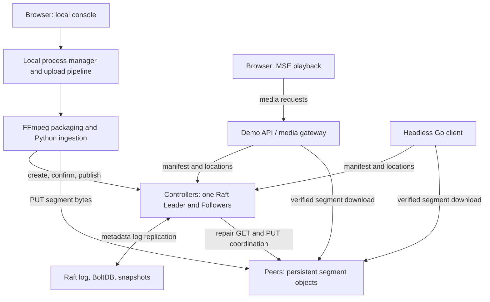

# Cooperative Video: Research, Evaluation, and Presentation Plan

Prepared: November 14, 2026  
Code reviewed: `5f19b19`  
Purpose: a working guide for the final report, experiment scripts, and a ten-minute presentation.

**Status:** This document specifies research questions and an evaluation plan. It does not report uncollected performance results. “Implemented” describes code paths; “verified” requires evidence from a named test or archived experiment. Proposed scripts and measurements are explicitly identified below.

TODO(team): Retain regression coverage for the repaired correctness issues, collect the defined experiments, and replace result templates with measured findings before making final claims.

**Literature update:** The subsequent [literature review and research-focus recommendation](literature-review-and-research-focus.md) identifies close prior work and recommends making the playback/replica-repair tradeoff the central study. The placement/selection questions below remain useful supporting ablations; the proposed repair-budget treatment is not yet implemented or an accepted experimental result.

**Reading guide:** Start with [research questions](#2-research-questions-and-falsifiable-hypotheses), [architecture](#3-system-architecture-and-end-to-end-operation), [failure experiments](#7-failure-cases-and-script-designs), and the [presentation outline](#11-ten-minute-presentation-outline). Use Sections 6 and 8 when implementing the experiment scripts, and Sections 9–10 when deciding which conclusions the evidence supports.

## 1. Project framing and the four grading criteria

**Suggested title:** Reliable Video Delivery with Resource-Aware Placement and Deadline-Aware Replica Selection

**One-sentence description:** We built a distributed video delivery prototype with a replicated metadata service and persistent segment replicas, then investigate how placement and replica selection affect delivery under limited bandwidth and node failures.

The presentation should begin with a problem: a video segment can be safely stored and still arrive too late for playback. Replication addresses loss of a storage node, but replica location, available upload bandwidth, and download decisions determine whether playback can keep up. Additional copies also consume storage and repair traffic competes with foreground delivery.

| Criterion | Our argument | Evidence required |
|---|---|---|
| Importance | Reliable storage alone does not guarantee timely video delivery when nodes have unequal bandwidth or fail. | A workload with explicit playback demand, resource limits, and measured completion, startup, and stalls. |
| Novelty | Investigate the interaction between ingest-time placement and playback-time replica selection under a matched replica budget. | Related-work comparison plus controlled ablations showing when the combination helps, does not help, or hurts. |
| Difficulty | Coordinate durable storage, replicated application state, failure recovery, and concurrent verified downloads across real processes. | Protocol diagrams, application invariants, code responsibilities, and failure-injection evidence. |
| Completeness | Answer the scoped performance and recovery questions, including costs, failures, and limits. | Reproducible results for every stated hypothesis and a conclusion restricted to tested conditions. |

### 1.1 What is and is not our contribution

Our engineering contribution is the application protocol connecting durable Peer receipts, Raft metadata, publication, persistent repair tasks, and verified playback. Our proposed research contribution is an empirical characterization of placement/selection interactions and their behavior during failures.

Raft, replication, checksums, resource-aware placement, and deadline-aware streaming are established ideas. Their combination is **not sufficient evidence of novelty**. Before claiming that an aspect has not been explored, compare relevant cooperative/P2P video and replica-selection research. For each closest paper, record its placement policy, online selection policy, storage/bandwidth budget, fault model, and evaluation conditions. Identify a specific unanswered comparison rather than claiming a new consensus or streaming algorithm.

The project currently has strong implementation depth. Novelty remains a research-positioning task; completeness remains an evidence-collection task. A narrower, well-supported conclusion is stronger than a broad claim without experiments.

## 2. Research questions and falsifiable hypotheses

### RQ1 — Delivery performance at a fixed resource budget

**Question:** Under which bandwidth and load conditions do resource-aware placement and deadline-aware replica selection improve delivery compared with fixed placement and round-robin selection, when initial replica bytes, Peer limits, and playback settings are matched?

**H1 — Placement:** Under heterogeneous configured Peer upload capacities, adaptive placement reduces mean completed-session rebuffering relative to fixed placement at the same selection policy, without reducing completion rate. The expected benefit is smaller under homogeneous capacities.

**H2 — Selection:** At a fixed placement policy, deadline-aware selection reduces late consumed segments and completed-session rebuffering under constrained bandwidth, without reducing completion rate. Cold-start estimates and overly short timeouts are plausible reasons for this hypothesis to fail.

**Interaction question:** Does combining the two policies provide additional benefit, or does one remove the bottleneck that the other addresses? Treat interaction as an exploratory question unless a directional hypothesis is registered before collecting the final data.

These are hypotheses, not findings. We do not assume that the combined policy wins.

### RQ2 — Safety and recovery during failures

**Question:** Within an explicit crash/restart model, which failures can the system tolerate, what remains unavailable, and how long do application service and replica redundancy take to recover?

**H3a — Safety:** In the tested executions, incomplete or invalid uploads do not become published replicas; a metadata operation submitted entirely during sustained quorum loss is not acknowledged as committed; downloaded data is checked before consumption; committed state survives supported process restarts.

**H3b — Conditional recovery:** After a single Peer failure, delivery can switch to a surviving valid replica and redundancy can be restored if a reachable valid source, a distinct eligible target with capacity, and a Controller quorum remain available. After a Controller Leader crash, a communicating majority can restore metadata service and resume committed pending work.

Successful playback is additionally conditional on surviving bandwidth, buffering, and retry limits. H3b does not predict zero stalls or guarantee every session completes. Repeated tests provide empirical evidence, not a proof over all executions. Known violations must be reported and fixed or excluded explicitly; see Section 9.

### 2.1 What constitutes an answer

For each hypothesis, report the tested conditions, matched controls, measured differences, uncertainty, resource costs, and one verdict: **supported in the tested regime**, **not supported**, or **inconclusive**.

Do not infer noninferiority from a nonsignificant difference. Set an acceptable completion-rate loss before the final study; a strict “no observed loss” summary must still include uncertainty. If sample sizes cannot establish the chosen tolerance, say that the completion tradeoff remains inconclusive.

## 3. System architecture and end-to-end operation

### 3.1 Components and paths



Controllers hold manifests, publication status, committed replica receipts, deduplication results, and maintenance tasks. Peers hold video bytes and durable indexes. Video bytes bypass the Raft log. Repair traffic passes through the coordinating Controller, but ordinary ingestion and headless downloads transfer bytes directly to/from Peers.

The browser path includes a Gateway. It is not a fully decentralized browser-to-browser P2P network. The current single Gateway is also a separate failure domain; Controller replication does not make the entire browser delivery path highly available.

### 3.2 Upload, packaging, and publication

1. The local console starts the selected topology. The UI allows 2–8 Peers and 1 or 3 Controllers; topology changes require stopping and restarting the managed cluster. This is not live membership reconfiguration.
2. A trusted local user uploads a video. FFmpeg encodes one H.264/AAC timeline and the packaging tool extracts continuous fMP4 fragments.
3. A manifest identifies every segment by ID, index, duration, size, and SHA-256. The Controller creates a `DRAFT` through Raft.
4. The placement planner recommends at least two distinct targets per segment, plus optional copies within the configured per-video extra-byte budget.
5. The ingester sends bytes directly to each target Peer. The intended durable sequence is temporary write, size/hash verification, file synchronization, atomic installation, directory synchronization, and durable index update before returning a Receipt.
6. The Controller checks the object receipt against a configured Peer and commits the replica record through Raft.
7. The FSM allows `READY` publication only when every segment has at least two distinct committed holders. Playback metadata queries expose published content.

This is a staged application protocol, not a distributed transaction covering all disks. An interrupted ingest can leave a draft or unregistered bytes. Placement is advisory: there is no global persistent capacity reservation across concurrent ingests, although each Peer enforces its own quota.

### 3.3 Playback

The headless engine retrieves the manifest and locations, downloads through a bounded worker pool, verifies complete segments, and consumes them in media order using a simulated playback clock. It produces real transfer measurements and simulated playback metrics; it does not decode video.

For real video, the Gateway performs selection and verification, then returns the segment to the browser. The browser verifies the object and appends it to a persistent MediaSource/SourceBuffer. Browser media events measure actual startup and waiting. Headless and browser measurements must remain separate datasets.

### 3.4 Repair and maintenance

Peers periodically report inventory. The Leader's repair coordinator independently fetches and validates inventory from configured Peer URLs. After a grace period with insufficient reachable valid replicas, it commits a repair task, copies from a valid source to an eligible target, checks the returned Receipt, and atomically commits replica registration with task completion.

Pending tasks survive Controller changes through the replicated state. Default coordination/reporting intervals are approximately two seconds and the production repair grace is six seconds. The existing test harness overrides the grace to one second. Record the actual configuration; repair latency is not simply equal to the grace period. Repairs are processed serially, and per-cycle work plus inventory scans and network time add delay.

Manual cleanup retires excess replicas while retaining two verified copies. Video deletion records durable intent, hides the video, and schedules replica removals. These are useful correctness extensions, not the principal performance contribution.

## 4. Distributed techniques, implementation ownership, and design rationale

| Technique or dependency | How we use it | Why it matters for the questions | Main code |
|---|---|---|---|
| HTTP/JSON request-response communication | Metadata operations, receipts, inventory, tasks, and binary segment transfers | Exposes timeout, retry, and partial-failure behavior that the protocol must handle | `internal/protocol/`, service handlers |
| HashiCorp Raft | Leader election and replicated metadata commands | Keeps publication and task decisions consistent during Controller failures | `internal/metadata/raft.go` |
| Deterministic replicated FSM | Apply commands without network or clock side effects | Replicas agree on application state, not just raw log entries | `internal/metadata/fsm.go` |
| Leader verification and apply barrier | Synchronize application metadata reads through the Leader | Avoid answering authoritative queries from an arbitrary stale Follower | `internal/metadata/handlers.go`, `raft.go` |
| BoltDB and file snapshots | Persist Raft log/stable state and application snapshots | Recover committed metadata across process restart | `internal/metadata/raft.go` |
| Immutable content-addressed files and durable indexes | Store blobs by SHA-256, map segment IDs to receipts | Verify content and avoid overwriting a different object | `internal/storage/` |
| Application-level dual replication | Publish after two distinct confirmed holders per segment | Retain a source after one holder fails; replication is separate from metadata consensus | `internal/metadata/fsm.go` |
| Operation IDs and deduplication | Replay matching commands, reject ID reuse with different contents | Resolve retry ambiguity without pretending transport provides exactly-once execution | `internal/metadata/fsm.go`, `internal/storage/store.go` |
| Inventory verification and persistent repair tasks | Separate observations from committed replica state | Restore redundancy and retain work across Leader changes | `internal/control/`, `internal/metadata/maintenance.go` |
| Shared Peer upload limiter | All segment GETs share a Peer bandwidth budget, including repair GETs | Makes foreground/repair contention observable under controlled limits | `internal/storage/handlers.go` |
| Bounded concurrency, prefetch, cancellation | Limit active transfers and cancel obsolete work | Keep playback policies comparable at fixed client resources | `internal/playback/` |
| FFmpeg, fMP4, MSE | Package and demonstrate real audiovisual playback | Shows application functionality beyond a storage-only prototype | `scripts/media/`, browser playback code |
| Python process orchestration | Start isolated clusters, inject faults, collect traces | Repeatable evidence for performance and recovery | `tests/system/`, `experiments/` |

We use the Raft library rather than claiming to implement the consensus algorithm ourselves. The substantial programming work is the application FSM, durable Peer store, staged publication, repair lifecycle, maintenance protocols, and concurrent playback engine. The library's role and the algorithm's election/log-safety foundations should be attributed to [HashiCorp Raft](https://github.com/hashicorp/raft) and the [Raft paper](https://raft.github.io/raft.pdf).

### 4.1 Connections to course material

- **RPC:** A timeout cannot establish whether a remote side effect happened. Stable operation IDs and outcome reconciliation are application responsibilities.
- **Primary-Backup:** Useful comparison for single-primary coordination and failover. Our metadata recovery uses Raft quorum rules rather than assuming that an arbitrary backup can become primary safely.
- **Raft:** Directly used for application metadata and persistent task state. With three Controllers, two communicating members are required for quorum-backed progress.
- **GFS:** The relevant analogy is separating metadata coordination from chunk transfer, together with replica monitoring and repair. Our video-specific delivery objective adds playback timing. We do not implement GFS's complete interface or semantics. See the [GFS paper, Sections 2.3–2.4](https://storage.googleapis.com/gweb-research2023-media/pubtools/4446.pdf).
- **ZooKeeper:** A comparison point for coordination services, not a dependency we deployed.
- **Chord, MapReduce, Spark, Ray, Borg, BigTable, Spanner, and blockchain:** Do not claim their use based on superficial similarities. In particular, calling a storage node a Peer does not imply DHT routing.

### 4.2 How Controller Leader failure is handled

The Raft library handles randomized election timeouts, terms, voting, and log freshness constraints. A candidate needs a majority; a new Leader continues from the consensus-protected history. An isolated old Leader cannot independently commit new metadata. Client retries and application task recovery then restore useful service. The relevant guarantee concerns committed state, not preservation of every uncommitted request. These election and safety principles come from the [Raft paper](https://raft.github.io/raft.pdf).

Report three separate milestones: failure injection, observation of a replacement Leader, and completion of a fresh quorum-backed application request. `/health` only proves that a process responds; `/cluster` role information alone is not proof of usable metadata service.

## 5. Policies being evaluated

### 5.1 Fixed versus adaptive placement

Fixed placement rotates the initial target order by segment index and skips targets without sufficient observed space. Adaptive placement ranks eligible targets using normalized free space and configured upload bandwidth. The bandwidth weight is 0.8 for segment indexes 0–2 and 0.5 afterward. Current HTTP observations set online availability to 1 for responding nodes; this is not learned long-term reliability.

Both policies first allocate two replicas for every segment. Optional extra copies are allocated in segment order using the same extra-byte budget. Planning deducts expected bytes within that plan, but does not reserve capacity globally.

Interpret adaptive as **resource-aware ingest-time placement**, not popularity learning, continuous rebalancing, or measured end-to-end bandwidth prediction. Also test whether concentrating objects on the fastest Peers creates hotspots.

### 5.2 Round robin versus deadline-aware selection

Round robin rotates replica order by segment index. Deadline-aware selection ranks candidates by predicted transfer completion using segment size, session-local EWMA throughput, in-flight requests, and failure penalties. It also assigns bounded attempt timeouts using urgency.

Both paths download in a bounded sequential prefetch structure. The main treatment is source selection and timeout budgeting, not a new global earliest-deadline-first queue. Estimates do not capture the full queue across all independent sessions. The browser Gateway has no direct knowledge of actual browser playback deadlines; headless timing and browser timing are different.

### 5.3 Required ablation groups

| Group | Placement | Selection | Purpose |
|---|---|---|---|
| A | Fixed | Round robin | Baseline |
| B | Fixed | Deadline | Selection effect |
| C | Adaptive | Round robin | Placement effect |
| D | Adaptive | Deadline | Combined behavior |

For a metric `Y`, compare `B-A`, `C-A`, `D-C`, and `D-B` on matched runs. The factorial interaction is `D-C-B+A`. For lower-is-better metrics, a negative interaction indicates an improvement beyond the additive differences on that metric's scale. A combined policy merely beating either individual policy does not establish synergy. Interpret conditional metrics cautiously when completion populations differ.

## 6. Shared experiment protocol and measurements

### 6.1 Existing starting points

The repository already provides:

| File | Existing purpose | Needed extension |
|---|---|---|
| `experiments/paired.py` | Fresh clusters, seeded multi-video arrivals, four policy groups, matched initial byte checks, source/binary provenance | Broader workload cells, scheduled faults, longer measurement windows, and richer metrics |
| `experiments/compare.py` | Run-level paired comparisons against A | All ablation contrasts, interaction, startup/late-segment metrics, and completion-aware uncertainty |
| `tests/system/cluster.py` | Temporary directories, process start/kill/restart, ingestion | Configurable Peer count/quotas, direct timed probes, artifact preservation before cleanup |
| `tests/system/smoke.py` | End-to-end acceptance including failover and quorum loss | Quantitative timeline recording |
| `tests/system/repair.py` | Repair across Leader failure | Separate repair-only and combined-fault measurements |
| `tests/system/media.py` | Real media delivery, hashes, decoding, stored fragment timing; optional browser checks | Retain timeline regressions and record actual browser QoE |
| `tests/system/cleanup.py`, `delete_video.py` | Maintenance safety and recovery | Latency, retry, and partial-progress records |

Current paired defaults are diagnostic: three videos, three viewers, six 150 ms segments, and 32 KiB per segment. These very short sessions provide few throughput observations and are not a convincing general video-performance study. The current reusable cluster harness has three Peers even though the UI supports more. Generalize it before claiming a Peer-count scaling result.

### 6.2 Minimum study scope

**Performance core:** four groups × homogeneous/heterogeneous upload caps × low/contended demand, using at least ten paired workload seeds initially. This gives 160 runs. Set the replication count before the final study and increase it if uncertainty remains too wide; five seeds are acceptable for a pilot, not automatically sufficient for a final conclusion.

Choose load levels in a separate pilot, then freeze them. Estimate offered demand from viewer count and segment bytes per media second, and verify actual per-Peer utilization. Total cluster bandwidth alone can hide a placement hotspot. Match total configured bandwidth across homogeneous and heterogeneous profiles when attributing an effect to heterogeneity.

Use videos long enough for startup, estimation, sustained load, and any scheduled failure to occur. A practical starting point is at least 60 seconds of logical media with explicitly chosen segment size and duration. Record the aggregate Peer quota needed by the longer fixtures; the current harness's 16 MiB per-Peer default may need adjustment. Keep segment transfers within the engine's finite timeouts for the selected offered load.

**Failure core:** F1, F3, F4, and F5 below, with at least ten repetitions per chosen configuration. First characterize the mechanism under A; repeat relevant streaming cases under D and the other ablations if the report claims policy robustness during failures. A complete cross-product is unnecessary if the claim is narrower and clearly stated.

**Correctness extensions:** execute the remaining applicable cases as acceptance tests. They need pass/fail evidence and traces; they do not all need a large statistical performance matrix. F12 is optional unless network-partition behavior becomes a headline claim.

### 6.3 Controls for every paired run

Hold constant the manifest bytes and durations, video-choice/arrival trace, Peer identities and caps, quota, initial replica bytes, optional-replica budget, client window/concurrency/startup buffer, Controller membership/timeouts, repair settings, and observation horizon. Fault comparisons must also preserve the fault rule and recovery schedule.

Reset process state, Raft/store directories, throughput estimates, counters, and limiter state between runs. Fresh process state does not guarantee a cold OS file cache; record that limitation or control cache conditions consistently. Use distinct synthetic bytes so content deduplication does not silently change physical storage budgets.

Run measured clusters serially on an otherwise quiet host. Vary group order independently of workload seeds. Record machine, OS, tool versions, commit/dirty state, binary hashes, configuration, seed, manifest/trace hashes, and raw output. Local processes share a machine and disk failure domain; they emulate node-level process failures, not independent machine or power failures.

Initial storage and configured bandwidth are controls. Actual transfer bytes, retries, repair bytes, and storage growth are outcomes; do not discard runs merely because those outcomes differ.

### 6.4 Metric definitions

| Metric | Definition and interpretation |
|---|---|
| Completion rate | Completed sessions / all scheduled sessions. Count start failures, playback failures, and timeouts in the denominator. |
| Startup latency | Session start to initial playable prefix in headless mode; initial request to first `playing` in browser mode. Keep the two definitions separate. |
| Rebuffering ratio | Headless stall time / (simulated media consumed + stall time), excluding startup. Report as completed-session conditional alongside completion. |
| Deadline misses | Consumed noninitial segments verified after their original playback deadlines. Failed/unconsumed segments are not counted by the current engine. Never interpret a low count without completion. |
| Time to failure / progress | Failure timestamp and media consumed before failure, so fast-failing sessions cannot look efficient. |
| Verified-delivery recovery | Injection to first post-injection validated response from a surviving source. Only applies when the fault actually affected the tested path. |
| Redundancy recovery | Injection to two reachable, hash-valid, committed holders for the affected segment. Historical location count alone is insufficient. |
| Metadata recovery | Injection to first successful fresh quorum-backed manifest query or idempotent metadata write. Define the probe in advance. |
| Transfer cost | Delta of summed Peer `uploaded_bytes` over the same fixed run horizon, including repair GET traffic. Application response-body bytes, not wire bytes. |
| Repair cost | Source/target/task event accounting for repair transfers. Existing Peer totals combine repair and playback and cannot isolate this without added instrumentation or a separate no-viewer experiment. |
| Storage | Initial bytes, sampled peak, and final bytes. Initial/final maxima suffice only when storage is monotonic; cleanup experiments require sampling. |

Use one harness monotonic clock for injection and probe timestamps. Client UTC timestamps and local elapsed clocks are useful records but must not be subtracted across processes as if perfectly synchronized. Capture client events with harness receipt times, or add an explicit time-alignment mechanism and quantify its error.

Aggregate at the run/seed level. Sessions sharing a cluster are not independent experimental repetitions. Report paired differences and uncertainty, not only pooled session means. Use median and range for small recovery samples; estimate tail percentiles only with enough repetitions and label uncertainty. Record timeouts as censored/unrecovered runs, not missing data or zero latency. State polling resolution, for example 200 ms; measured recovery has polling uncertainty and probes may perturb the system.

## 7. Failure cases and script designs

Each case must save configuration, injection records, task/probe events, session outcomes, resource counters, and explicit correctness checks. “Expected” below means the intended contract to evaluate, not an assertion that every path is already verified.

### F0 — No-fault baseline

**Purpose:** Establish normal outcomes and quantify any overhead from polling and artifact capture.

**Script design:** Ingest, verify READY and all initial receipts, capture counters, launch the fixed viewer trace, sample status until the fixed observation horizon, and collect terminal outcomes. Reuse `experiments/paired.py`. Include a marker at the planned fault time but inject nothing so corresponding fault runs are comparable.

**Data:** completion, startup, rebuffering, misses, per-Peer traffic, storage, and unexpected repair tasks. This is the denominator for fault overhead, not a failure test itself.

### F1 — One Peer crashes during delivery

**Handling:** Failed downloads try other replicas. After verified replica shortage and a grace interval, a Raft task coordinates copying to a distinct eligible Peer. Existing committed locations may still include the offline holder.

**Script design:** Use three Controllers and at least three Peers with two initial copies and no optional third copy for the target segment. Query actual holders. In a fixed A run, choose a Peer scheduled to serve a not-yet-buffered segment; kill it at a recorded demand event. Ensure the session is long enough to observe repair. Verify the surviving delivery hash, then independently verify the new committed replica. Extend `repair.py` and the playback event collector.

**Paired-policy rule:** For A/D comparisons, use the same Peer ID and injection time in the primary experiment and report whether it held/requested affected content under each policy. A separate “kill the actively serving holder” experiment is valid but is a policy-dependent fault treatment and must be labeled separately.

**Data:** first failed attempt, first validated surviving-source response, stalls, completion, task creation/completion, verified redundancy timeline, and total traffic. Do not count successful playback from previously buffered data as measured source failover.

**Boundary:** If both holders fail before repair finishes, the segment may be unavailable. The repair path cannot reconstruct absent bytes. Reconciliation now recovers an already-installed valid copy even when the original holders have stopped; see Section 9's follow-up status.

### F2 — A Peer is slow rather than dead

**Handling:** Selection estimates can change source preference; bounded attempt timeouts permit retry. Slow responses need not imply a dead Peer.

**Script design:** First compare predefined static slow-Peer caps using existing harness rate configuration. To inject a mid-session slowdown, add a test proxy that throttles segment responses and records traffic; no runtime cap-changing API currently exists. Measure all groups with identical proxy topology and schedule. Restarting a Peer with a new cap also causes a crash/cache reset and must be labeled as a combined event.

**Data:** throughput-estimate evolution, chosen sources, request timeouts, misses, completion, stalls, and retry bytes. This directly tests H2 and whether aggressive timeouts cause regressions. Proxy-added delay and accounting must be recorded.

### F3 — Controller Leader crashes during playback

**Handling:** Raft elects a replacement when a majority remains connected. Metadata clients retry transient failures within finite limits; fresh cached entries can mask the outage. Media leases are independent of the Controller process.

**Script design:** Identify the current Leader and kill that process. Run two separately labeled modes: a warm active session and a demand for metadata absent from that client's cache. Independently send direct, bounded manifest probes to configured Controllers, logging each attempt without the ingestion helper's hidden retry loop. Track roles plus actual usable metadata. Extend `smoke.py`/`media.py`; do not restart the Gateway just to clear caches in the active-session continuity mode.

**Data:** injection time, replacement-Leader observation, first successful fresh application probe, per-attempt errors, startup/stalls/completion, and total client recovery time. Show metadata recovery separately from playback continuity.

**Boundary:** A cached session continuing proves only the cached path remained usable. A health response or a reported Leader does not establish quorum-backed service. Elections longer than retry/buffer budgets can still fail sessions.

### F4 — Leader crashes while a repair task is pending

**Handling:** The repair task is durable application state. A new Leader inspects pending work and attempts to complete it; completion and replica registration are committed together.

**Script design:** Trigger F1, poll for a committed pending repair, record its task ID, then kill the Leader. Verify that the replacement completes that same task and that its target is a valid committed holder. In a separate post-check, stop the remaining original holder and download from the repaired target. Reuse `repair.py`.

**Data:** task IDs/states, pending duration, metadata recovery, total repair time, retry traffic, and target hash. Separate the extra post-check fault from the primary latency measurement.

**Measurement caution:** A tiny repair can complete before the harness observes `pending`. Use a sufficiently large fixture and controlled transfer rate, or add an explicit test-only gate. Record “injection precondition missed” rather than counting such a run as successful task recovery. Do not retry selecting only favorable runs without reporting misses.

### F5 — Controller majority is lost

**Handling:** New quorum-backed metadata progress stops. Cached reads/data transfers may continue within their own limits. Metadata disks are not necessarily lost just because the service is unavailable.

**Script design:** Commit and verify a baseline video, then stop two of three Controllers and wait for the survivor to recognize quorum loss. Submit a unique metadata command entirely inside the isolated interval; record 503/timeout and no success acknowledgment. Restore a member and reconcile that operation using its original ID, while verifying baseline state. Reuse the quorum scenario in `smoke.py`.

**Data:** outage length, every write response, recovery probes, preexisting state verification, and reconciliation outcome. Any request already in flight at isolation is classified separately as an unknown outcome.

**Boundary:** A 503 is not universal proof that a command never committed. Commands submitted after stable quorum loss must not be acknowledged as successful during isolation; a pending command may legally commit after quorum returns. Process stops are not a network-partition test.

### F6 — Interrupted upload, lost response, and duplicate request

**Handling:** Partial/invalid byte uploads should not install a valid object. Metadata and Peer stores track operation IDs. Matching retries and conflicting ID reuse have distinct behavior. There is no automatic rollback of an entire ingest.

**Script design:** Add a raw HTTP uploader or test proxy with three deterministic modes: close the connection before the advertised body completes; forward a complete PUT but drop its response; forward a metadata command but hide its response. Retry the exact request with the same operation ID, then test changed contents under that ID. Verify Peer receipt/index, quota, replica count, DRAFT/READY state, and Controller state after reconciliation. Existing storage tests provide basic interrupted-upload/idempotency coverage.

**Data:** acknowledged versus unknown outcomes, installed objects, committed replicas, conflict responses, extra bytes, and recovery latency. The script must not claim exactly-once network execution.

**Required regression:** Drop a repair PUT response after durable installation and let the task fail. Check whether later coordination adopts or reuses the valid unregistered target. This now has a passing coordinator regression and an isolated-cluster adoption check. Equivalent PUT/deletion regressions cover receipt aliases, retirement, and persisted legacy indexes; retain them while extending the study.

### F7 — A stored replica is corrupted or missing

**Handling:** Playback verifies size/hash and tries another source; verified inventory and receipt checks exclude invalid objects. A raw Peer GET can still send corrupt bytes; the consuming verifier is essential. Repair can copy from a surviving valid source to a distinct eligible target.

**Script design:** In an isolated data directory, alter one known blob without changing the manifest. Verify inventory exclusion, receipt rejection, client hash failure/switch, and subsequent third-Peer repair. Repeat with a missing file. Use unique hashes so shared-content deduplication does not affect unrelated objects. Start with storage reliability tests and F1's collector.

**Data:** detection delay, verification failures, successful alternate bytes, repair progress, and storage retained by invalid blobs.

**Boundary:** Existing damaged committed holders are not overwritten automatically. With only two Peers, there may be no eligible third target even when playback from one copy remains possible. No valid remaining source means no reconstruction.

### F8 — Capacity exhaustion or concurrent ingest contention

**Handling:** Placement estimates space, but it is advisory. A Peer atomically enforces its quota and rejects a new object that does not fit. Publication requires the full replica condition.

**Script design:** Extend harness quota configuration. First choose a manifest that cannot obtain two full copies and verify explicit failure. Then run concurrent ingests that independently receive plausible plans but compete for remaining capacity. Record each PUT, confirmation, and publish outcome; verify physical accounting after restart and whether incomplete videos remain unavailable.

**Data:** planned versus installed bytes, capacity rejections, successful ingests, drafts, and unregistered/orphan bytes. Include peak usage and partial failure state.

**Boundary:** Do not claim all-or-nothing ingest, global reservations, or automatic reclamation. Expected behavior is a safe explicit failure, not guaranteed concurrent ingest success.

### F9 — Restart of Peers, Controllers, or the playback API

**Handling:** Peer indexes and Controller Raft state persist on disk. Pending metadata tasks can resume. The Demo API restores headless journal snapshots and marks interrupted sessions stopped; media leases and browser playback position are not restored.

**Script design:** Restart each component type separately using its original data directory. Verify committed manifests, receipts, downloaded hashes, task state, and headless terminal status. For a Gateway crash during browser playback, record eventual request failure or temporary buffered continuation; restart it and create a new media session. Extend `smoke.py`, `console.py`, and session persistence tests.

**Data:** component/application recovery times, pre/post hashes and counters, pending-task outcomes, and session status. Record that Peer byte counters reset on process restart, so traffic deltas require per-instance accounting.

**Boundary:** Gateway restart is a demonstrated availability limit, not transparent browser-session failover. Abrupt process kill tests do not certify disk/controller failure or power-loss behavior at every synchronization boundary.

### F10 — Cleanup/deletion with offline nodes, Leader changes, or retries

**Handling:** Cleanup removes a target from advertised locations, persists a task, and requires quorum-backed authorization plus two verified retained copies before removal. Video deletion hides the manifest and keeps per-replica removals pending until offline nodes return. Tombstones prevent specific retired operations from being replayed.

**Script design:** Reuse `cleanup.py` and `delete_video.py`: make the target offline, submit the operation, change Leader, restore the target, and verify final state/bytes after restart. Test a shared blob and confirm deleting one segment reference preserves another reference. Add “same object, different upload operation” and delayed older-PUT replays before and during deletion.

**Data:** pending/completed tasks, time after node restoration to completion, retained-copy hashes, logical versus physical bytes reclaimed, and idempotency/conflict results.

**Boundary:** Whole-video deletion is explicitly destructive; it does not preserve two copies of intentionally deleted content. Failure-ingest orphan collection is outside its scope. Equivalent-receipt matching and alias retirement now fix the reproduced receipt mismatch, while offline targets still legitimately keep deletion pending.

### F11 — All holders of a segment become unavailable

**Handling:** Clients eventually fail when no valid source can be reached. The Controller must not invent a successful repair. Metadata consensus cannot recreate video bytes.

**Script design:** In a fresh fixture, prevent repair from racing the injection by disabling it for this test or stopping all known holders together. Request the affected segment, observe explicit failure, and verify no fabricated completed task. Restore one holder with its disk intact and retry. An optional separate destructive test can remove all copies only inside disposable directories.

**Data:** time to explicit failure, failure/error classification, absent repair completion, and recoverability after a source returns.

**Boundary:** Temporary unavailability differs from permanent loss. Report this as the designed limit of replication, not as evidence that every failure should be recoverable.

### F12 — Network partition (optional extension)

**Handling:** Intended behavior is metadata progress only on a communicating majority; minority-side quorum-backed reads/writes must not succeed independently. Peer byte delivery follows separate reachability constraints.

**Script design:** Add a test-only network proxy or namespace/container network arrangement that can partition Raft traffic while keeping processes alive. Advertised Raft endpoints must traverse the proxy, including already-open connections. Isolate the old Leader from the other two, probe both sides directly, verify majority progress/minority refusal, heal the partition, and compare application state. Separately specify which HTTP/Peer links remain reachable.

**Data:** partition schedule, per-side requests, roles/terms, commit/recovery observations, and post-heal state. Distinguish commands acknowledged before partition, commands during partition, and ambiguous in-flight commands.

**Boundary:** This infrastructure is not in the current simple process-kill harness. Do not label F3/F5 as partition coverage or claim sustained-partition validation without implementing it.

## 8. Concrete specification for the experiment scripts

### 8.1 Proposed files, not implemented by this document

- `experiments/failure_study.py`: scenario selection, isolated topology lifecycle, direct probes, injection, and data capture. Build on `tests/system/cluster.py`.
- `experiments/analyze_failure_study.py`: per-run recovery/safety tables and aggregate plots.
- Extend `experiments/paired.py` / `compare.py` for workload cells, all four contrasts, and factorial interaction rather than building another playback engine.

Implement scenario handlers with a shared lifecycle:

```text
validate configuration and allocate a unique output directory
start fresh cluster; wait for a usable metadata Leader and healthy Peers
ingest fixture; verify initial hashes, READY, replica budget, and preconditions
capture counters; start bounded collectors and fixed viewer trace
wait for the declared time/event; record fault request and confirmed effect
observe to a fixed horizon; restore nodes according to the declared schedule
reconcile unknown outcomes; perform scenario-specific correctness checks
record all terminal outcomes, timeouts, and missed injection preconditions
copy raw logs, task snapshots, configuration, and evidence before temp cleanup
stop only harness-owned processes in a finally block
```

Existing helpers such as `ing.controller()` hide multiple retries and sleeps. They are convenient for setup but unsuitable for measuring individual metadata outage attempts. Measurement code needs its own direct one-attempt probe with explicit timeout, start/end timestamps, response status, and error.

### 8.2 Proposed output contract

```text
results/<study-id>/
  environment.json
  source-and-binary-provenance.json
  study-config.json
  runs.jsonl
  summary.csv
  <run-id>/
    config.json
    workload-trace.json
    manifest.json
    injections.jsonl
    metadata-probes.jsonl
    task-snapshots.jsonl
    peer-stats.jsonl
    sessions.jsonl
    client-events.jsonl
    correctness.json
    controller-*.log
    peer-*.log
```

Every record should identify `run_id`, `seed`, `group`, `scenario`, and observation time. Injection records need both requested and confirmed times, selected node/task/segment IDs, the selection rule, and whether the precondition was satisfied. Summaries need run status (`completed`, `timed_out`, `setup_failed`, `precondition_missed`), safety-check outcomes, recovery observations/censoring, and all session outcomes. Never fabricate an event timestamp when no such event was observed.

Use independent observer timestamps to calculate recovery. Store `null` plus an explicit unrecovered/censored reason when recovery is not observed by the deadline. Preserve logs before the current temporary-cluster context deletes its directory.

### 8.3 Commands available now

From the repository root:

```bash
make backend
go vet ./...
go test -race ./...
python3 tests/system/smoke.py
python3 tests/system/repair.py
python3 tests/system/cleanup.py
python3 tests/system/delete_video.py
python3 tests/system/media.py
python3 experiments/paired.py --output-dir results/paired-pilot
python3 experiments/compare.py results/paired-pilot/runs.jsonl
```

Run these serially when evaluating performance. The paired output directory must be new or empty. These commands provide current acceptance/pilot evidence; they do **not** implement the extended quantitative failure study described here. Do not relabel diagnostic output as a final study merely by changing `formal_experiment`.

## 9. Evidence status, known issues, and claim boundaries

The following is a record of the earlier review in this chat on November 14, 2026, not a new execution performed when writing this document:

| Evidence | Status and permissible interpretation |
|---|---|
| `go vet ./...`, backend build, `go test -race ./...` | Passed in the reviewed environment after allowing local test listeners. Supports implementation validation, not universal correctness. |
| Smoke, repair, cleanup, and video-deletion system checks | Passed their existing scenarios. They provide acceptance evidence, not a quantitative recovery distribution. |
| Valid unregistered repair target | Reproduced defect: inventory sees correct bytes but the coordinator skips the uncommitted holder as both source and target. A lost successful repair response can leave this state after task failure. |
| Receipt changed by repeated PUT | Reproduced defect: a same-object PUT using a new operation ID replaces the Peer Receipt; a task using the earlier Receipt can no longer delete it, leaving the video `DELETING`. |
| Real-media system check | Failed a packet-timestamp continuity assertion (`775` versus expected `512`) with local FFmpeg 7.1. The discrepancy also occurred in locally packaged data, and the joined stream decoded. Packaging/measurement interpretation needs investigation; uninterrupted browser playback is not established by this run. |
| Formal performance conclusions | Not established. Existing documented paired diagnostics were labeled nonformal, and are not a substitute for archived final-study data. |

**Follow-up status:** The earlier defects in this historical table have now been addressed: verified replica adoption and installed-target resume recover lost acknowledgments; canonical receipts, immutable-object matching, and durable alias retirement keep maintenance retryable; exact BMFF timing validation replaces the incorrect nominal-packet-duration assumption. Backend race/static checks and isolated repair, cleanup, deletion, and media checks pass. See [the verification follow-up](../docs/verification.md#backend-recovery-and-media-validation-fixes-2026-11-14). Actual target-browser continuity and formal policy-performance results remain separate uncollected evidence. Keep the same validated binary set throughout a study.

Additional boundaries to state when relevant:

- Crash/restart and corruption tests assume a trusted, non-Byzantine environment; there is no authentication/TLS security contribution.
- Historical ACKs do not prove that replicas are currently reachable or intact. Verify current bytes for recovery claims.
- Two replicas tolerate loss of one holder of a segment, not arbitrary correlated loss. Local disks/processes share a host.
- No global persistent reservation, general orphan GC, task-history compaction, online membership changes, learned popularity, erasure coding, hedging, or transparent Gateway failover.
- Metadata cache fallback is bounded and covers only previously fetched entries; it is not unconditional offline playback. Authoritative 404/409 responses are not treated as election failures.
- A stopped single Controller has no alternate to elect. Use three Controllers for the failover claim.
- Repair traffic shares Peer upload limits, but physical NIC traffic and TCP overhead are not measured by the current application counters.

## 10. How to write complete answers after collecting data

### 10.1 Required result exhibits

1. **Performance:** Four-policy plots across homogeneous/heterogeneous and low/contended workload cells. Show completion prominently beside startup and completed-session rebuffering; include late segments and total transfer cost.
2. **Ablation:** Paired `B-A`, `C-A`, `D-C`, `D-B`, and interaction estimates with uncertainty. Explain hotspots and timeout failures rather than hiding them.
3. **Peer recovery:** Annotated timeline showing injection, verified alternate delivery, repair-task creation, and verified two-copy restoration. Include distribution and unrecovered count.
4. **Controller recovery:** Replacement-Leader observation and fresh-metadata recovery, with warm/cold playback outcomes distinguished.
5. **Safety:** A scenario table listing correctness check, passes/attempts, failed or missed injections, and evidence location. Put broad extensions in the appendix.

### 10.2 Result table to fill, not invent

| Question | Conditions | Evidence to insert | Verdict to fill |
|---|---|---|---|
| H1: does placement help? | Matched selection, bandwidth profile, load, and replica budget | Paired completion/stall/startup differences and traffic | Supported / not supported / inconclusive |
| H2: does selection help? | Matched placement and playback parameters | Late segments, completion/stalls, retries, and timeout failures | Supported / not supported / inconclusive |
| Interaction | All four matched groups | `D-C-B+A` plus uncertainty and tradeoffs | Complementary / redundant / harmful / inconclusive |
| H3a: are safety checks met? | Named failure model and scenarios | Per-check outcomes, conflicting/ambiguous requests, hashes | Holds in tested cases / violated |
| H3b: how does recovery work? | Surviving source/target/quorum and fixed retry budgets | Delivery, redundancy, and metadata recovery with timeout counts | Conditional recovery observed / limit identified |

### 10.3 Suggested final-answer structure

For RQ1: “Under [specified profile and load], [policy] changed [metric] by [measured amount and uncertainty] relative to [matched baseline], with [completion outcome] and [transfer/storage cost]. Under [other conditions], the benefit [disappeared/reversed/remained uncertain]. The ablation attributes this to [supported mechanism].”

For RQ2: “For [named injected faults], the system [observed safety outcomes]. Metadata service recovered in [distribution], validated alternate delivery in [distribution], and redundancy in [distribution], with [timeouts/failures]. Recovery required [conditions]. [Named cases] were unavailable or violated the intended contract.”

Negative findings can answer a research question completely. Finishing more UI controls cannot replace missing comparisons, and passing a few fault checks cannot support universal data-loss or zero-stall claims.

## 11. Ten-minute presentation outline

This schedule assumes ten minutes includes the live page demonstration and excludes separate Q&A. If Q&A is included, shorten the demo and mechanism discussion before removing results.

| Time | Slide / activity | What to show and say | Grading purpose |
|---|---|---|---|
| 0:00–0:40 | 1. Problem and stakes | “A segment can exist on disk and still arrive too late.” Show limited storage, unequal Peer bandwidth, and failures. | Importance |
| 0:40–1:20 | 2. Questions and hypotheses | State RQ1/RQ2; introduce placement versus selection and conditional recovery. | Novelty and completeness |
| 1:20–2:20 | 3. Architecture | One control/data-path diagram; explain why only metadata enters Raft and why browser and headless paths differ. | Difficulty and design rationale |
| 2:20–3:10 | 4. Safe publication and recovery | One upload-to-READY sequence and a Peer/Leader failure sketch. Attribute Raft library versus our application protocol. | Difficulty |
| 3:10–5:10 | 5. Live normal-path demonstration | Select 3 Peers and 3 Controllers; start; upload a short prepared video; show packaging/import stages; play; point to real segment sources. | End-to-end implementation |
| 5:10–6:00 | 6. Policy experiment | Four-group table, matched budgets, workload profiles, and real-transfer/headless measurement scope. | Novelty and experimental rigor |
| 6:00–7:20 | 7. Performance findings | Completion beside stall/startup; one ablation figure; state a measured answer and a counterexample or uncertainty. | Answer RQ1 |
| 7:20–8:20 | 8. Peer failure findings | Prepared timeline: kill → verified alternate delivery → repair completion. Distinguish service from redundancy recovery and show transfer cost. | Answer part of RQ2 |
| 8:20–9:30 | 9. Controller failure and safety | Leader/application recovery plot; majority-loss refusal; explain what cached playback does and does not prove. | Answer remaining RQ2 |
| 9:30–10:00 | 10. Conclusions and limits | One sentence answering each RQ, one tradeoff, and one explicit boundary. No new results or features. | Completeness |

Total: **10:00**, including a **2:00 live demo**. Keep failure measurements precomputed and available locally; a live crash is optional and must replace another segment rather than extending the schedule.

### 11.1 Demo preparation and narration

- Rehearse the exact small input on the presentation machine and browser. Use a unique video ID generated by the console, confirm tools/ports beforehand, and keep a local recording of the same workflow if setup or encoding exceeds the two-minute allocation.
- Show Peer-count selection as configurable deployment size, not automatic online scaling. Use three Controllers so the architecture matches the recovery discussion.
- Narrate the distributed protocol during progress: “The upload is packaged into segments; each segment is durably installed on distinct Peers; the Controller publishes only after the required confirmations.”
- During playback, identify data sources and verification. Do not treat a successful short demonstration as a performance experiment.
- If upload processing has not finished at the hard cutoff, use the rehearsed recording or an already imported video and state that transition. Do not spend the results section waiting for FFmpeg.

### 11.2 Suggested slide visuals and backup slides

Use one message per slide: architecture arrows, a short publication sequence, the four-policy matrix, paired result plots, and failure timelines. Put implementation details and full safety tables in backup slides.

Prepare backup answers for: Why Raft instead of a single controller? Why two replicas? Why use a Gateway? What happens if both copies disappear? Why is the research contribution novel? How are resources matched? What did the team implement versus import? Why are the measurements headless? What remains a single point of failure?

## 12. Final report organization and completion checklist

Suggested report sections:

1. **Abstract:** Problem, system, scoped research questions, actual principal findings.
2. **Motivation and related work:** Importance, nearest prior work, and the precise unresolved comparison.
3. **Model and hypotheses:** Resources, fault assumptions, success definitions, and falsifiable claims.
4. **Design and implementation:** Architecture, application protocols, policy differences, and implementation ownership.
5. **Evaluation methodology:** Four-group design, controls, workload/fault schedules, provenance, metrics, and uncertainty.
6. **Results:** Direct RQ1/RQ2 answers, ablations, recovery distributions, failures, and costs.
7. **Limitations and conclusion:** External validity, unresolved defects, unsupported fault classes, and the boundaries of the answer.

Before final submission:

- [ ] Related work supports the precise novelty statement; no claim that Raft or replication is new.
- [ ] Known correctness defects have regression evidence or are explicitly reported as violations.
- [ ] Target-machine media/browser checks support every playback claim.
- [ ] Every policy comparison matches controls and includes all scheduled sessions.
- [ ] Fault scripts preserve raw evidence and distinguish missed injections, censored recovery, and actual passes.
- [ ] Headless, browser, acceptance, and formal performance evidence are labeled separately.
- [ ] Each hypothesis has a measured verdict, including negative or inconclusive outcomes.
- [ ] Every quantitative slide can be traced to archived runs and configuration.
- [ ] The presentation fits ten minutes with the demo cutoff and recording fallback.

## 13. Primary references and code entry points

**External foundations:** [Raft paper](https://raft.github.io/raft.pdf), [HashiCorp Raft implementation](https://github.com/hashicorp/raft), and [GFS paper](https://storage.googleapis.com/gweb-research2023-media/pubtools/4446.pdf). These explain foundations and comparisons, not the novelty of our policy combination. Streaming-specific related-work review remains necessary.

**Repository map:** `cmd/controller/`, `cmd/peer/`, `cmd/demo-api/`, `cmd/local-console/`; `internal/metadata/`, `internal/storage/`, `internal/control/`, `internal/placement/`, `internal/playback/`; `scripts/ingest/`, `scripts/media/`; `tests/system/`; `experiments/paired.py`, `experiments/compare.py`, and `experiments/scenarios/main.json`.

Existing documentation contains historical verification records and some stale descriptions. For current capabilities, reconcile the running code, specific test evidence, and this document's status distinctions rather than combining claims across versions.
